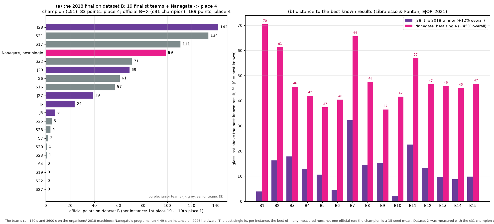
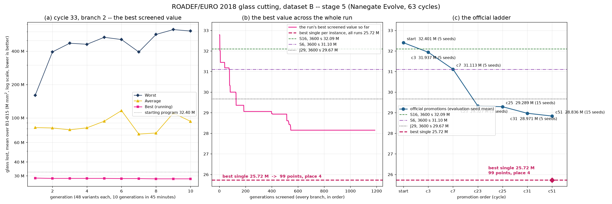

# Results: the stage-5 run on dataset B

Nanegate's Evolve platform ran this example's fifth stage on a cloud VM from
30 September to 5 October 2026. It started from stage 4's champion and ran 63
cycles, until it was stopped safely. Everything below is in this folder: the
programs, the answers, the platform's measurements and a script that checks them.

## In one table

Mean glass lost over B1–B15 (mm², smaller is better). Points: the 2018 final's
rule on dataset B, with our row inserted among the final's 19 teams. On each
instance, rank r earns max(0, 11 − r), against the teams' official
0.1 × 180 s + 0.9 × 3600 s results.

| | mean glass lost | points, place | above the best known |
|---|---|---|---|
| stage 5's starting program (stage 4's champion), 5 seeds | 32,400,928 | 70, 6th | +82.3% |
| **stage 5's champion** (cycle 51), 15 seeds | **28,836,031** | **83, 4th** | +62.3% |
| **best single**, per instance (the answers in `best-single/`) | **25,721,304** | **99, 4th** | +44.7% |
| J28, the 2018 winner (Libralesso & Fontan) | 19,945,508 | 142, 1st | +12.2% |
| the best known results (Libralesso & Fontan, EJOR 291(3) 2021) | 17,771,204 | — | 0 |

The 2018 final ranked teams on datasets B and X together. Dataset X was measured
only with the cycle-31 champion: **169 points, 4th** (J28 286, S21 264, S17 235).
From the cycle-7 champion to the cycle-31 champion, the loss on B (the instances
the search measured) fell 6.9%, while on X (never seen) it fell 0.5%. The run had
no held-out instances, so the platform could not see that gap while it searched.

## How to read the comparison

- **This is not an entry.** The challenge closed in 2018. These numbers are placed
  in its published final table after the fact.
- **The hardware and the time differ.** The teams ran 180 s and 3600 s on the
  organisers' 2018 machines. These programs stop on a fixed work budget, not a
  clock, and took 4–49 s an instance on a 2026 VM (c4-highcpu-24).
- **The best single is a selection, the champion is not.** The best single takes,
  per instance, the best of every run measured in this lineage. That is the 64
  programs whose runs the platform stored, on its 5 or 15 evaluation seeds, plus
  two local seed sweeps:
  - B1 is the best of seeds 1–40 of a stage-3 program;
  - B8 is the best of seeds 1–10 of a stage-5 archived program.

  It shows what the lineage can produce. The fair figure for one program is the
  champion's 15-seed mean.

## The run

Five evaluation seeds an instance, fifteen to confirm, four branches a cycle of 45
minutes each, a promotion multiplier of 1.3. More than 1,180 generations of 48
program variants were screened. A platform bug, a tunable constant declared twice, stopped
the run at cycle 22. The bug was fixed and the run resumed from its checkpoint.

| promoted at cycle | mean glass lost | seeds an instance |
|---|---|---|
| start | 32,400,928 | 5 |
| 3 | 31,937,362 | 5 |
| 7 | 31,112,991 | 5 |
| 23 | 29,327,332 | 5 |
| 25 | 29,289,197 | 15 |
| 31 | 28,971,065 | 5 |
| **51** | **28,836,031** | **15** |

After cycle 51 nothing beat the champion. Twice the search went back to an archived
candidate rather than stop, and found nothing there either. The run was stopped
at cycle 63. Every promoted program is in `programs/`, rebuilt from the recorded
patches; `programs.json` gives each one's tree hash.

## The best single, instance by instance

"Its place" is the place that value takes among the final's 19 teams on that
instance.

| instance | best single (mm²) | its place | points | above best known | champion c51, 15-seed mean | its place |
|---|---|---|---|---|---|---|
| B1 | 4,535,958 | 6 | 5 | +70.4% | 6,405,890 | 11 |
| B2 | 19,240,265 | 4 | 7 | +61.3% | 21,179,961 | 5 |
| B3 | 22,983,623 | 4 | 7 | +45.6% | 25,428,145 | 5 |
| B4 | 10,387,645 | 4 | 7 | +42.0% | 11,253,917 | 4 |
| B5 | 99,109,985 | 8 | 3 | +37.4% | 108,579,485 | 11 |
| B6 | 15,166,027 | 5 | 6 | +40.4% | 17,054,577 | 5 |
| B7 | 10,981,599 | 3 | 8 | +65.7% | 14,881,963 | 4 |
| B8 | 21,239,269 | 3 | 8 | +47.5% | 24,257,739 | 3 |
| B9 | 22,521,067 | 3 | 8 | +36.5% | 26,091,015 | 4 |
| B10 | 31,083,983 | 5 | 6 | +41.6% | 33,386,409 | 5 |
| B11 | 32,371,670 | 5 | 6 | +56.9% | 35,035,756 | 6 |
| B12 | 18,340,357 | 4 | 7 | +46.6% | 20,840,091 | 4 |
| B13 | 33,038,865 | 4 | 7 | +45.8% | 37,459,035 | 5 |
| B14 | 11,635,210 | 4 | 7 | +45.0% | 12,621,108 | 4 |
| B15 | 33,184,031 | 4 | 7 | +46.7% | 38,065,371 | 6 |
| **mean** | **25,721,304** | | **99** | **+44.7%** | **28,836,031** | |

## How each answer was checked

1. **The platform's record.** Thirteen of the fifteen were measured by the
   platform. Each was then reproduced bit for bit: the program was rebuilt from its
   patches (tree hash checked), compiled with the platform's flags
   (`g++ -std=c++20 -O2 -DNDEBUG -D_GLIBCXX_ASSERTIONS`) and run on its evaluation
   seed, giving the recorded objective exactly. B1 and B8 come from the local
   sweeps named above.
2. **The plain-Python reading.** `verify.validity_reasons` and `verify.objective`,
   the rules of `problem.txt` written out in loops: all fifteen valid, the same
   objectives.
3. **The challenge's official checker.** All fifteen answers report
   `validSolution` and the same objective.

`provenance.json` gives, for each answer, the program file, its tree hash and the
seed.

## Files

| path | what it is |
|---|---|
| `programs/` | the stage-5 starting program and the six promoted programs, with `programs.json` (cycle, candidate, tree hash, the mean loss it was promoted with) |
| `best-single/B1.json` … `B15.json` | the fifteen answers, in the format `problem.txt` defines |
| `best-single/provenance.json` | per answer: objective, checks, program, tree hash, seed |
| `best-single/programs/` | the source of every program behind an answer, named by tree hash |
| `champion-c51-scores.json` | the platform's measurement of the champion: 15 seeds × 15 instances |
| `check.py` | re-checks the answers, and with `--checker` and `--ranking` the rest |
| `run-chart.png`, `standing.png` | the charts above |

## Checking it yourself

The challenge's data and checker are not redistributed here. Get dataset B and the
checker from the ROADEF/EURO 2018 challenge's site, and unpack them into `data/`:
`data/dataset_B/*.csv`, and the checker with its
`data/checker/instances_checker/global_param.csv`. Then:

    python make_instance.py               # instances.json: sha256 826fc809d159c15a0b69a7e46647914519eb298b1636a51cc1832801880b22a0
    python results/check.py               # the fifteen answers by the Python reading
    python results/check.py --checker     # ... and by the official checker

To rerun a program, compile it with the line above and give it one element of
`instances.json`:

    candidate instance.json answer.json --seed N

The programs are deterministic: one seed, one answer.
